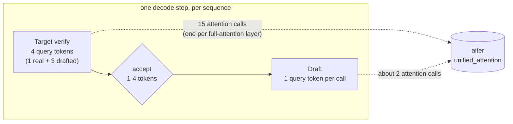
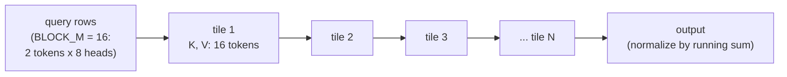
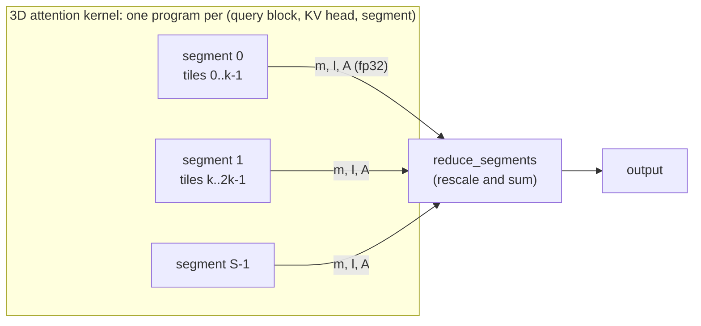
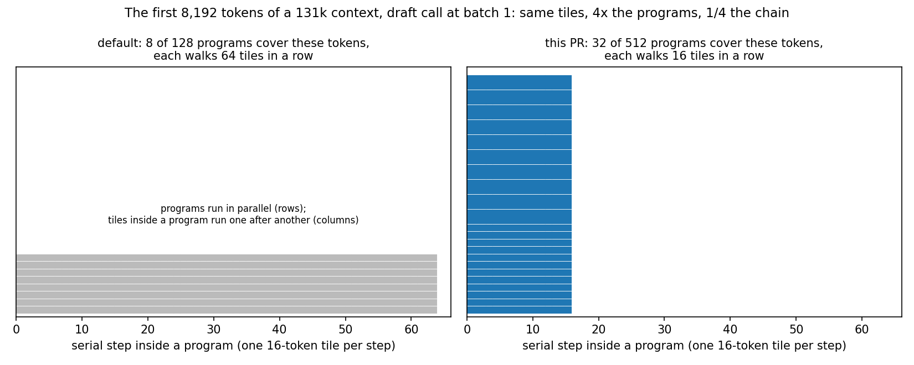
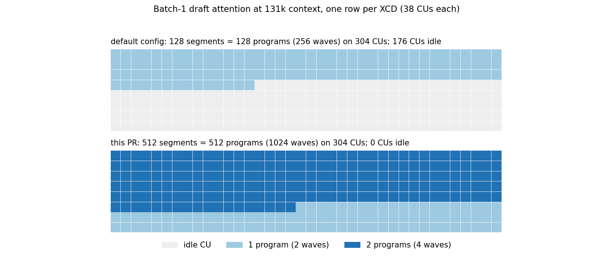
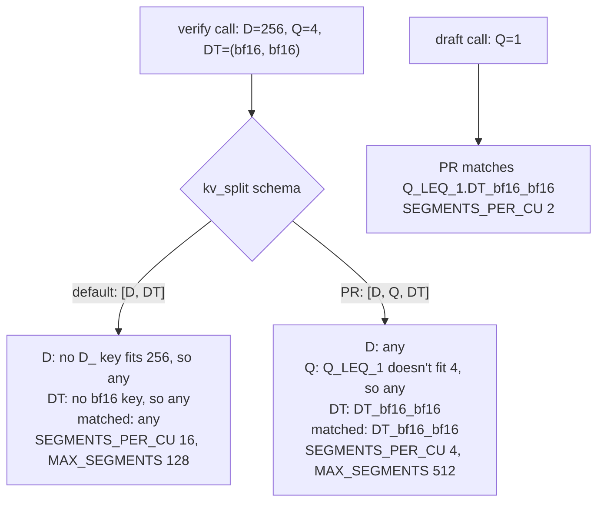
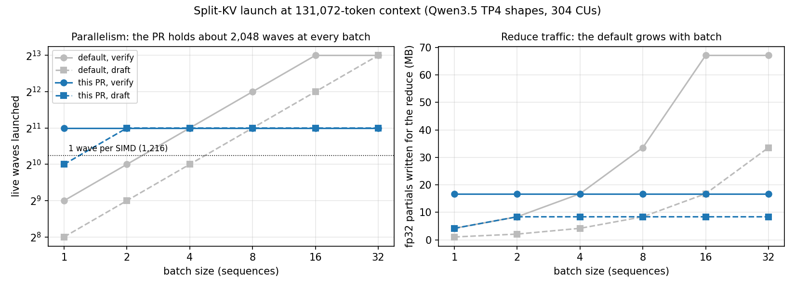
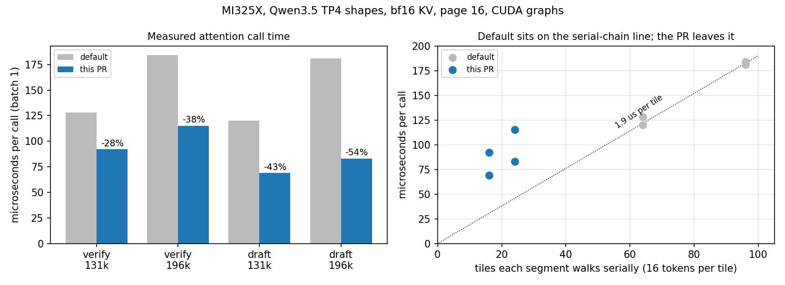

# gfx942 unified attention split-KV config, from first principles

Companion to the PR on branch `gfx942-ua-kv-split-config`. It builds up from what a decode attention call does to why four numbers in a JSON file make it up to 54% faster on MI300X/MI325X. Code links point at aiter `ef0a5a26`, the commit the PR is based on.

**Contents**

1. [The workload](#1-the-workload)
2. [Decode attention is a memory problem](#2-decode-attention-is-a-memory-problem)
3. [One program, one serial loop](#3-one-program-one-serial-loop)
4. [Too few programs: the 2D grid at batch 1](#4-too-few-programs-the-2d-grid-at-batch-1)
5. [Split-KV adds a third grid axis](#5-split-kv-adds-a-third-grid-axis)
6. [The GPU side: CUs, SIMDs, waves](#6-the-gpu-side-cus-simds-waves)
7. [How aiter picks the number of segments](#7-how-aiter-picks-the-number-of-segments)
8. [What the PR changes, knob by knob](#8-what-the-pr-changes-knob-by-knob)
9. [Results](#9-results)
10. [Trade-offs and open questions](#10-trade-offs-and-open-questions)
11. [Play with it](#11-play-with-it)
12. [Further reading (good visuals)](#12-further-reading-good-visuals)

---

## 1. The workload

Qwen3.5-397B-A17B served with tensor parallelism 4 and MTP speculative decoding. Each decode step runs the target model once to **verify** the drafted tokens, and the small draft model to **draft** the next ones.



What one GPU sees in each attention call:

| | Value |
|---|---|
| Query heads per GPU | 8 |
| KV heads per GPU | 1 (so 8 query heads share each KV head: GQA) |
| Head size | 256 |
| KV cache | bf16, paged, 16 tokens per page |
| Query tokens per sequence | 4 for verify, 1 for draft |
| Context | 64k–200k tokens in our agentic workload |

Speculative decoding background, with good animations: [Google Research, "Looking back at speculative decoding"](https://research.google/blog/looking-back-at-speculative-decoding/).

## 2. Decode attention is a memory problem

For every token in the context, the call reads its K and V vectors and does a little math with them.

- **Bytes per context token:** K + V = 2 × 256 × 2 bytes = **1 KB**.
- **FLOPs per context token:** 8 heads × q tokens × 256 × 2 (multiply-add) × 2 (QKᵀ and PV) = **32 KFLOP for verify** (q = 4), **8 KFLOP for draft** (q = 1).

So verify does about 32 FLOP per byte and draft about 8. An MI325X does about 1,300 TFLOP/s of dense bf16 matrix math against about 6 TB/s of HBM, a ratio of about 220 FLOP per byte. Both calls are far below that: their speed is set by how fast the KV cache can be streamed, not by the math.

At 131k context the KV of one sequence is 134 MB. Streamed at 6 TB/s that's about 22 µs. **The default config takes 120–128 µs**, so most of the GPU's bandwidth is unused. The rest of this doc is about why.

Roofline intuition with great pictures: [Horace He, "Making Deep Learning Go Brrrr From First Principles"](https://horace.io/brrr_intro.html).

## 3. One program, one serial loop

The kernel uses FlashAttention's tiled, online softmax. One GPU program (a workgroup) takes a block of query rows and walks the KV range **tile by tile**: load 16 tokens of K, compute scores, update a running max and sum, load 16 tokens of V, accumulate. It never stores the full score row.



Each step depends on the previous one: the running max and sum carry over. So **a program's time is roughly (number of tiles it walks) × (time per tile)**, and the time per tile is mostly memory latency, not bandwidth, when few programs share the GPU.

- Online softmax, step by step: [Zihao Ye, "From Online Softmax to FlashAttention"](https://courses.cs.washington.edu/courses/cse599m/23sp/notes/flashattn.pdf).
- Visual walkthrough: [Aleksa Gordić, "ELI5: FlashAttention"](https://gordicaleksa.medium.com/eli5-flash-attention-5c44017022ad).
- Paged KV (why tiles are pages): [vLLM, "PagedAttention"](https://blog.vllm.ai/2023/06/20/vllm.html).

## 4. Too few programs: the 2D grid at batch 1

The basic launch is a 2D grid: (query blocks) × (KV heads). [`unified_attention`](https://github.com/ROCm/aiter/blob/ef0a5a26b8cb38ea1308f827985e36cde964a6ab/aiter/ops/triton/attention/unified_attention.py#L342-L363) packs 8 query heads × 2 query tokens into one 16-row block, so:

| Call, batch 1 | Query blocks | KV heads | 2D programs |
|---|---|---|---|
| Verify (4 tokens) | 4 / 2 + 1 = 3 (one is an empty upper-bound block that exits) | 1 | 3 |
| Draft (1 token) | 1 | 1 | 1 |

One to three programs on a GPU with 304 compute units. Each would walk the whole 131k context alone: 8,192 tiles in a row. That's why [`use_2d_kernel`](https://github.com/ROCm/aiter/blob/ef0a5a26b8cb38ea1308f827985e36cde964a6ab/aiter/ops/triton/attention/unified_attention.py#L198-L235) sends small launches (2D programs ≤ 4 × CUs = 1,216) to the 3D split-KV kernel.

Figure 7 of [PyTorch, "Enabling vLLM V1 on AMD GPUs With Triton"](https://pytorch.org/blog/enabling-vllm-v1-on-amd-gpus-with-triton/) draws this exact 2D grid. aiter's `unified_attention` descends from that kernel.

## 5. Split-KV adds a third grid axis

Split-KV (Flash-Decoding) cuts each sequence's context into **segments** and gives each segment its own program. The grid becomes (query blocks) × (KV heads) × (segments). Each program writes a partial result: its running max $m_s$, its running sum $\ell_s$ and its unnormalized output $A_s$. A second, small kernel ([`reduce_segments`](https://github.com/ROCm/aiter/blob/ef0a5a26b8cb38ea1308f827985e36cde964a6ab/aiter/ops/triton/_triton_kernels/attention/unified_attention.py#L1012)) merges them exactly:

$$m = \max_s m_s, \qquad O = \frac{\sum_s e^{m_s - m} A_s}{\sum_s e^{m_s - m}\,\ell_s}$$



In the [3D kernel](https://github.com/ROCm/aiter/blob/ef0a5a26b8cb38ea1308f827985e36cde964a6ab/aiter/ops/triton/_triton_kernels/attention/unified_attention.py#L680-L695), segment `s` covers `cdiv(seq_len, NUM_SEGMENTS × TILE_SIZE)` tiles of the sequence's *actual* length, and segments past the end return at once.



More segments mean a shorter serial chain per program, but more programs to schedule and more partials to write and reduce. **Picking `NUM_SEGMENTS` is the whole game**, and that's what the config controls.

The best visual of this idea is the animation in [Tri Dao et al., "Flash-Decoding for long-context inference"](https://crfm.stanford.edu/2023/10/12/flashdecoding.html) (also on the [PyTorch blog](https://pytorch.org/blog/flash-decoding/)). Split-KV came to this kernel family in [vLLM #19152](https://github.com/vllm-project/vllm/pull/19152); the [vLLM Triton backend deep dive](https://vllm.ai/blog/2026-03-04-vllm-triton-backend-deep-dive) covers the 2D/3D design.

## 6. The GPU side: CUs, SIMDs, waves

An MI300X or MI325X has 8 compute dies (XCDs) with 38 active compute units (CUs) each: 304 CUs. Each CU has 4 SIMDs. A Triton program with `num_warps=2` is a workgroup of 2 wavefronts (64 lanes each), and each wave runs on one SIMD.

A SIMD hides memory latency by switching between the waves it holds: while one waits for HBM, another computes. With **one or zero waves per SIMD, nothing hides the latency**, and every tile costs a full round trip to memory.



With the default config, a batch-1 draft call at 131k launches 128 programs (256 waves) for 1,216 SIMDs: 176 CUs get nothing, and the busy ones hold one program each. With the PR, 512 programs fill every CU, most with two.

- Occupancy and latency hiding, with diagrams: [AMD GPUOpen, "Occupancy explained"](https://gpuopen.com/learn/occupancy-explained/).
- XCD and CU layout, with die diagrams: [ROCm docs, "AMD Instinct MI300 Series microarchitecture"](https://rocm.docs.amd.com/en/latest/reference/gpu-arch/mi300.html) and the [CDNA 3 white paper](https://www.amd.com/content/dam/amd/en/documents/instinct-tech-docs/white-papers/amd-cdna-3-white-paper.pdf).
- Why a grid that's slightly larger than the GPU wastes a "wave" of time: [NVIDIA, "Wave quantization"](https://docs.nvidia.com/deeplearning/performance/dl-performance-matrix-multiplication/index.html#wave-quant).

## 7. How aiter picks the number of segments

Two steps: look up a config entry, then derive `NUM_SEGMENTS` from it.

**Lookup.** Each op in `DEFAULT.json` is a flat table whose keys name only the axes that matter, joined by `.`. The `schema` says which axes exist and in what order. [`_lookup`](https://github.com/ROCm/aiter/blob/ef0a5a26b8cb38ea1308f827985e36cde964a6ab/aiter/ops/triton/utils/unified_attention_utils.py#L154-L168) tries the most specific key per axis, leftmost axis first, and falls back to `any`.



**Derivation.** [`compute_segment_params`](https://github.com/ROCm/aiter/blob/ef0a5a26b8cb38ea1308f827985e36cde964a6ab/aiter/ops/triton/utils/unified_attention_utils.py#L182-L237), simplified to the knobs these entries use:

```python
tile   = max(SEGMENT_TILE_MIN, min(SEGMENT_TILE_MAX, next_pow2(page_size)))  # tokens a segment must cover
limit  = min(MAX_SEGMENTS, cdiv(max_seqlen_k, tile))      # never split finer than `tile` tokens
budget = num_CUs * SEGMENTS_PER_CU                        # total programs to aim for
share  = cdiv(budget, num_2d_programs)                    # segments per 2D program
NUM_SEGMENTS = next_pow2(max(min(MIN_SEGMENTS, limit), min(limit, share)))
```

Read it as: **aim for `SEGMENTS_PER_CU` programs per CU in total, spread over the 2D programs, but never more than `MAX_SEGMENTS` and never finer than `tile` tokens per segment.** Then round up to a power of two.

Worked example, verify at batch 1, 131,072 tokens of context, 3 2D programs:

| | Default | This PR |
|---|---|---|
| `tile` | max(1, min(64, 16)) = 16 | max(256, min(256, 16)) = 256 |
| `limit` | min(128, 131072 / 16) = **128** | min(512, 131072 / 256) = 512 |
| `budget` | 304 × 16 = 4,864 | 304 × 4 = 1,216 |
| `share` | 4,864 / 3 = 1,622 | 1,216 / 3 = 406 |
| `NUM_SEGMENTS` | next_pow2(min(128, 1622)) = **128** (capped) | next_pow2(min(512, 406)) = **512** |
| Programs that do work | 2 × 128 = 256 (512 waves) | 2 × 512 = 1,024 (2,048 waves) |
| Tiles per segment | 131072 / (128 × 16) = **64** | 131072 / (512 × 16) = **16** |

The default's budget asks for 1,622 segments per query block, but the 128 cap throws almost all of that away.

## 8. What the PR changes, knob by knob

```diff
   "kv_split": [
     "D",
+    "Q",
     "DT"
   ]
 ...
 "kv_split": {
+  "Q_LEQ_1.DT_bf16_bf16": { "MIN_SEGMENTS": 8, "MAX_SEGMENTS": 512, "SEGMENT_TILE_MIN": 256,
+                            "SEGMENT_TILE_MAX": 256, "TILE_SIZE_MIN": 1, "TILE_SIZE_MAX": 64,
+                            "SEGMENTS_PER_CU": 2 },
+  "DT_bf16_bf16":         { ...same..., "SEGMENTS_PER_CU": 4 },
```

| Knob | Default | PR | What it does |
|---|---|---|---|
| `MAX_SEGMENTS` | 128 | 512 | Lifts the cap that starved batch 1. |
| `SEGMENTS_PER_CU` | 16 | 4 (verify), 2 (draft) | Sets the total target. 304 × 4 ≈ 1,216 programs ≈ 2,048 live waves after rounding, about 1.7 per SIMD. The default's 16 per CU only "works" at high batch, where it overshoots. |
| `SEGMENT_TILE_MIN/MAX` | 1 / 64 | 256 / 256 | A 256-token floor per segment, so short contexts aren't split into slivers whose partials cost more than their work. |
| `Q` axis | none | `Q_LEQ_1` vs the rest | Verify launches three 2D programs per sequence (two that work) and draft one, so verify splits its budget three ways. Half the per-CU target for draft puts both at about 2,048 live waves from batch 2 up. |
| fp8 KV entries | | unchanged | Not measured. |

The values came from a sweep, not from this derivation; the table is the reading of why they work. The result is a **constant parallelism target**, where the default grows with batch:



- **Left:** the PR launches about 2,048 live waves at every batch size (draft at batch 1 is 1,024, capped by `MAX_SEGMENTS`). The default starts at 256–512 and climbs to 8,192.
- **Right:** partial results written for the reduce stay at 8–17 MB with the PR. The default reaches 67 MB at batch 16–32, traffic the reduce kernel then reads back. That's the likely source of the batch 2–32 gains (up to 10%), though they weren't profiled separately.

## 9. Results

MI325X, Qwen3.5 TP4 shapes, bf16 KV, page size 16, CUDA graphs, run through aiter's real config lookup. Outputs match the default config.



- **Left (measured):** 28–54% faster at batch 1.
- **Right (measured times, derived tile counts):** with the default config, all four cases sit on one line, about **1.9 µs per tile**. The call time is the length of the serial chain: latency-bound, as section 6 predicts. The PR's points sit well above their own 16–24-tile chains: they're now limited by something else, which is a good sign.

Effective bandwidth (unique KV bytes ÷ time; verify's second query block may re-read KV, partly from the 256 MB Infinity Cache, so its true traffic is higher):

| Call, batch 1 | Default | PR | HBM peak |
|---|---|---|---|
| Verify, 131k | 1.05 TB/s | 1.46 TB/s | about 6 TB/s |
| Verify, 196k | 1.09 TB/s | 1.75 TB/s | |
| Draft, 131k | 1.12 TB/s | 1.95 TB/s | |
| Draft, 196k | 1.11 TB/s | 2.42 TB/s | |

At batch 2–32: equal or up to 10% faster, except +2% at batch 2–4 with 65k context.

**End to end** (SGLang prefill/decode disaggregated serving, multi-turn agentic workload, config the only change): batch-1 decode step 13.93 → 13.51 ms at concurrency 2 and 16.71 → 14.95 ms at concurrency 8. **Accuracy:** full GSM8K 0.727 with the PR vs 0.703 default.

## 10. Trade-offs and open questions

- **More partials at batch 1.** Verify at 131k writes 16.8 MB of fp32 partials, against 4.2 MB with the default. It's still a net win here, but it's the cost that bounds how far `SEGMENTS_PER_CU` can go.
- **Head sizes.** The new keys don't name `D`. Because `D` is the leftmost axis, the existing `D_GEQ_512` entry still wins for head size 512 and up, so the new entries cover every head size below 512 with bf16 or fp16 KV (aiter tags both as `bf16`). Only 256 was measured. A different `num_queries_per_kv` changes `BLOCK_M` and the 2D program count, so the right per-CU target may differ.
- **CUDA graphs.** `NUM_SEGMENTS` is computed on the host from `max_seqlen_k`, so a captured graph keeps the value it was captured with. The kernel still adapts the tiles per segment to each sequence's real length, but the grid size is fixed. [aiter #7088](https://github.com/ROCm/aiter/pull/7088) (gfx950) changes how this works; if it lands, re-measure.
- **MI300X** is the same gfx942 target with 304 CUs, but lower HBM bandwidth. Not measured.
- **Precedent.** [aiter #6983](https://github.com/ROCm/aiter/pull/6983) added `max_seqlen_q`-keyed split-KV entries for gfx950. This PR does the same for gfx942.

## 11. Play with it

- `segments.py` (next to this file) reproduces aiter's launch math without a GPU: `python segments.py --ctx 65536 131072`. It prints segments, live waves, tiles per segment and partial-result MB for default and PR across batch sizes.
- `make_figures.py` regenerates the figures in `img/`.
- On a GPU, aiter's own [`explain()`](https://github.com/ROCm/aiter/blob/ef0a5a26b8cb38ea1308f827985e36cde964a6ab/aiter/ops/triton/utils/unified_attention_utils.py#L365-L395) prints which config key a call matched and the derived `NUM_SEGMENTS`.

## 12. Further reading (good visuals)

| Topic | Link |
|---|---|
| Split-KV, animated | [Flash-Decoding for long-context inference](https://crfm.stanford.edu/2023/10/12/flashdecoding.html) |
| This kernel's 2D and 3D grids, with figures | [PyTorch: Enabling vLLM V1 on AMD GPUs With Triton](https://pytorch.org/blog/enabling-vllm-v1-on-amd-gpus-with-triton/) |
| The Triton backend's design | [vLLM Triton attention backend deep dive](https://vllm.ai/blog/2026-03-04-vllm-triton-backend-deep-dive) |
| Online softmax derivation | [From Online Softmax to FlashAttention](https://courses.cs.washington.edu/courses/cse599m/23sp/notes/flashattn.pdf) |
| FlashAttention, illustrated | [ELI5: FlashAttention](https://gordicaleksa.medium.com/eli5-flash-attention-5c44017022ad) |
| Memory-bound vs compute-bound | [Making Deep Learning Go Brrrr](https://horace.io/brrr_intro.html) |
| Occupancy and latency hiding | [GPUOpen: Occupancy explained](https://gpuopen.com/learn/occupancy-explained/) |
| MI300 dies, CUs, caches | [ROCm: MI300 microarchitecture](https://rocm.docs.amd.com/en/latest/reference/gpu-arch/mi300.html) |
| Wave quantization | [NVIDIA: matrix multiplication background](https://docs.nvidia.com/deeplearning/performance/dl-performance-matrix-multiplication/index.html#wave-quant) |
| Paged KV cache | [vLLM: PagedAttention](https://blog.vllm.ai/2023/06/20/vllm.html) |
| Speculative decoding | [Google Research: Looking back at speculative decoding](https://research.google/blog/looking-back-at-speculative-decoding/) |
| Stream-K style decode partitioning (an alternative to fixed splits) | [Lean Attention](https://arxiv.org/abs/2405.10480) |
